<div align="center">


# ⚡ Ai Connect
### Connect AI Coding Agents to WordPress over Model Context Protocol (MCP)

[](https://wordpress.org)
[](https://php.net)
[](https://modelcontextprotocol.io)
[](https://www.gnu.org/licenses/gpl-2.0.html)
[](https://github.com/aymanali98/ai-connect/releases)

<p align="center">
  <b>Give Claude Code, Cursor, Windsurf, VS Code Copilot, Claude Desktop, Google Antigravity & ChatGPT real, gated access to inspect, develop, and maintain your WordPress site.</b>
</p>

[Key Features](#-key-features) • [43 Built-In Tools](#-the-43-mcp-tools-catalog) • [Client Setup](#-connect-your-ai-client) • [Security Guardrails](#-multi-layer-security-architecture) • [Design System](#-design-system-engine) • [Installation](#-installation--quick-start)

---

</div>

## 🌟 Why Ai Connect?

Traditional AI workflows for WordPress are broken: you copy-paste code snippets into chat, struggle to explain file structures, and paste error logs back and forth.

**Ai Connect turns your WordPress site into a native MCP server.** Your AI assistant interacts directly with your site using 43 specialized tools: reading source files, running safe SQL queries, inspecting options, evaluating design tokens, executing WP-CLI commands, and managing plugins—all secured behind cryptographic tokens and granular admin permission gates.

```mermaid
flowchart LR
    subgraph Clients ["🤖 AI Coding Agents"]
        direction TB
        C1["Claude Code"]
        C2["Cursor / Windsurf"]
        C3["VS Code Copilot"]
        C4["Claude Desktop / Antigravity"]
        C5["ChatGPT Desktop"]
    end

    subgraph Protocol ["⚡ Transport Layer"]
        HTTP["Streamable HTTP (JSON-RPC 2.0)<br/><code>/wp-json/ai-connect/v1/mcp</code>"]
    end

    subgraph Security ["🛡️ Security Perimeter"]
        direction TB
        S1["Token Auth (SHA-256)"]
        S2["IP Rate Limiter (HTTP 429)"]
        S3["3-Tier Risk Gating & Master Switch"]
        S4["Path Guard & SQL Guard"]
    end

    subgraph WordPress ["🚀 Live WordPress Core"]
        direction TB
        W1[("Database ($wpdb)")]
        W2["Filesystem & Sandbox"]
        W3["WP-CLI & Core APIs"]
        W4["Async Jobs Engine"]
    end

    Clients -->|Bearer Token| HTTP
    HTTP --> Security
    Security --> WordPress
```



---

## ⚡ Key Features

<table>
  <tr>
    <td width="50%">
      <h3>🛠️ 43 Specialized Tools</h3>
      <p>Inspect site architecture, query databases, upload media, edit files precisely, run WP-CLI, and execute background tasks without HTTP timeouts.</p>
    </td>
    <td width="50%">
      <h3>🛡️ 4 Defensive Perimeters</h3>
      <p>Granular 3-tier risk gating (<code>read</code> / <code>write</code> / <code>dangerous</code>), Path Guard directory jail, SQL Guard single-statement checker, and IP brute-force throttling.</p>
    </td>
  </tr>
  <tr>
    <td width="50%">
      <h3>⚡ Streamable HTTP MCP</h3>
      <p>Fast, stateless JSON-RPC endpoint at <code>/ai-connect/v1/mcp</code> conforming to MCP protocols <code>2025-06-18</code>, <code>2025-03-26</code>, and <code>2024-11-05</code>.</p>
    </td>
    <td width="50%">
      <h3>🎨 Dynamic Design System</h3>
      <p>Automatically seeds palette colors, typography scales, and spacing units from <code>theme.json</code> or stylesheets so AI-generated UI matches your site's aesthetic.</p>
    </td>
  </tr>
  <tr>
    <td width="50%">
      <h3>🧪 Crash-Safe PHP Sandbox</h3>
      <p>Agent-generated code is confined to <code>wp-content/sitewright-sandbox/</code> with automated crash-recovery safe mode preventing site downtime.</p>
    </td>
    <td width="50%">
      <h3>⏱️ Asynchronous Jobs Engine</h3>
      <p>Long operations (plugin installations, heavy WP-CLI tasks) run in the background with status polling, eliminating proxy and gateway timeouts.</p>
    </td>
  </tr>
</table>

---

## 🛠️ The 43 MCP Tools Catalog

Every tool is assigned a strict risk classification:
* `🟢 Safe Read`: Gathers info without modifying site state.
* `🔵 Moderate Write`: Creates or updates standard content/settings.
* `🔴 Dangerous`: Executes arbitrary PHP/SQL, WP-CLI, or installs plugins.

<details open>
<summary><b>1. 🧭 Meta & Orientation Tools (3 tools)</b></summary>
<br>

| Tool Name | Risk Level | Description |
| :--- | :---: | :--- |
| `agent_context` | `🟢 Safe Read` | Returns site overview, active modes, server instructions, and design guidance. **Call this first!** |
| `discover_abilities` | `🟢 Safe Read` | Discovers registered abilities via the WordPress Abilities API (WordPress 6.9+). |
| `run_ability` | `🔵 Moderate Write` | Executes a registered WordPress ability by name with custom payload arguments. |

</details>

<details>
<summary><b>2. 🌐 Site Management & Lifecycle (12 tools)</b></summary>
<br>

| Tool Name | Risk Level | Description |
| :--- | :---: | :--- |
| `site_info` | `🟢 Safe Read` | Detailed environment report: WP/PHP versions, active theme, plugins, builders (Elementor/WooCommerce). |
| `list_plugins` | `🟢 Safe Read` | Lists all installed plugins with versions, active state, and update availability flags. |
| `install_plugin` | `🔴 Dangerous` | Installs plugins from WordPress.org repository by slug or from an external ZIP URL. |
| `update_plugin` | `🔴 Dangerous` | Updates an installed plugin to its latest available release. |
| `activate_plugin` | `🔵 Moderate Write` | Activates an installed plugin by its file slug. |
| `deactivate_plugin` | `🔵 Moderate Write` | Deactivates an active plugin cleanly. |
| `list_themes` | `🟢 Safe Read` | Lists installed themes, child/parent relationships, versions, and active status. |
| `list_users` | `🟢 Safe Read` | Lists users with IDs, usernames, display names, and roles (emails optional). |
| `diagnostics` | `🟢 Safe Read` | Automated system audit checking HTTPS, REST API, tables, sandbox status, WP-CLI, and cron. |
| `get_option` | `🟢 Safe Read` | Reads any `wp_options` row (including serialized arrays and objects). |
| `update_option` | `🔵 Moderate Write` | Updates safe options while blocking critical core keys (`siteurl`, `home`, `active_plugins`). |
| `clear_cache` | `🔵 Moderate Write` | Flushes WordPress object cache and detected page caches (LiteSpeed, WP Rocket, W3TC, etc.). |

</details>

<details>
<summary><b>3. 📝 Content Management (9 tools)</b></summary>
<br>

| Tool Name | Risk Level | Description |
| :--- | :---: | :--- |
| `get_posts` | `🟢 Safe Read` | Queries posts, pages, and custom post types with status, category, taxonomy, search, and pagination. |
| `get_post` | `🟢 Safe Read` | Retrieves a single post with full content, excerpt, post meta, taxonomy terms, and author details. |
| `create_post` | `🔵 Moderate Write` | Publishes or drafts posts, pages, or custom post types with metadata and terms. |
| `update_post` | `🔵 Moderate Write` | Modifies fields, content, or metadata of existing posts. |
| `delete_post` | `🔵 Moderate Write` | Trashes or permanently deletes posts (`force=true`). |
| `list_terms` | `🟢 Safe Read` | Lists taxonomy terms (categories, tags, custom taxonomies) with hierarchy and counts. |
| `create_term` | `🔵 Moderate Write` | Creates new taxonomy terms idempotently without duplicating existing slugs. |
| `list_comments` | `🟢 Safe Read` | Lists comments filtered by post, status, or author with pagination. |
| `moderate_comment` | `🔵 Moderate Write` | Approves, unapproves, spams, trashes, or permanently removes comments. |

</details>

<details>
<summary><b>4. 🖼️ Media Library (2 tools)</b></summary>
<br>

| Tool Name | Risk Level | Description |
| :--- | :---: | :--- |
| `list_media` | `🟢 Safe Read` | Lists media library attachments with URLs, MIME types, dimensions, and file sizes. |
| `upload_media` | `🔵 Moderate Write` | Uploads media directly into the library from a URL or base64-encoded payload (up to 10 MB). |

</details>

<details>
<summary><b>5. 📁 Filesystem Operations (6 tools)</b></summary>
<br>

| Tool Name | Risk Level | Description |
| :--- | :---: | :--- |
| `list_directory` | `🟢 Safe Read` | Traverses directories within jail root with recursion depth limits and entry caps. |
| `read_file` | `🟢 Safe Read` | Reads files with byte offsets and size caps (binaries returned base64-encoded). |
| `write_file` | `🔵 Moderate Write` | Writes full UTF-8 text files (executable PHP restricted to sandbox). |
| `edit_file` | `🔵 Moderate Write` | Performs targeted string replacements inside files (fails if target chunk is ambiguous). |
| `delete_file` | `🔵 Moderate Write` | Deletes a single file or empty folder (core WordPress directories strictly protected). |
| `rename_file` | `🔵 Moderate Write` | Renames or moves files (supports `.php.disabled` extension toggle to neutralize scripts). |

</details>

<details>
<summary><b>6. 🗄️ Database & SQL (4 tools)</b></summary>
<br>

| Tool Name | Risk Level | Description |
| :--- | :---: | :--- |
| `db_query` | `🟢 Safe Read` | Executes read-only SQL (`SELECT`, `SHOW`, `DESCRIBE`) with automatic LIMIT 200 and `{prefix}` replacement. |
| `db_execute` | `🔴 Dangerous` | Runs write/DDL SQL (`INSERT`, `UPDATE`, `DELETE`, `CREATE`, `ALTER`). Blocks multi-queries & system schemas. |
| `db_tables` | `🟢 Safe Read` | Lists all database tables with storage engines, row counts, and data size. |
| `db_describe` | `🟢 Safe Read` | Inspects table schemas, column types, keys, and indexes. |

</details>

<details>
<summary><b>7. 💻 Code Execution & WP-CLI (2 tools)</b></summary>
<br>

| Tool Name | Risk Level | Description |
| :--- | :---: | :--- |
| `run_php` | `🔴 Dangerous` | Evaluates PHP snippets inside the live WordPress runtime with full access to `$wpdb` and core functions. |
| `run_wp_cli` | `🔴 Dangerous` | Runs WP-CLI commands natively via `WP_CLI::runcommand` or system shell fallback with configurable timeouts. |

</details>

<details>
<summary><b>8. 🎨 Design System Engine (2 tools)</b></summary>
<br>

| Tool Name | Risk Level | Description |
| :--- | :---: | :--- |
| `design_get` | `🟢 Safe Read` | Reads design tokens (palette, typography, spacing, border radii) and page builder hints. |
| `design_update` | `🔵 Moderate Write` | Updates tokens or re-seeds them automatically from `theme.json` or active stylesheet. |

</details>

<details>
<summary><b>9. ⏱️ Asynchronous Background Jobs (3 tools)</b></summary>
<br>

| Tool Name | Risk Level | Description |
| :--- | :---: | :--- |
| `job_start` | `🔴 Dangerous` | Queues long-running operations (plugin installs, heavy WP-CLI) and returns a `job_id` immediately. |
| `job_status` | `🟢 Safe Read` | Checks job execution status (`queued`, `running`, `done`, `error`) and returns result payload. |
| `job_cancel` | `🔵 Moderate Write` | Cancels a queued background job before execution. |

</details>

---

## ⚡ Connect Your AI Client

Generating a connection takes **less than 60 seconds** in **Ai Connect → Connect AI**:
1. Check the **Enable Ai Connect** master switch.
2. Click **Create Token** (starts with `swt_...`).
3. Copy the configuration snippet below for your AI editor:

### 🖱️ Cursor
Add to `~/.cursor/mcp.json`:
```json
{
  "mcpServers": {
    "ai-connect": {
      "url": "https://example.com/wp-json/ai-connect/v1/mcp",
      "headers": {
        "Authorization": "Bearer swt_YOUR_TOKEN_HERE"
      }
    }
  }
}
```

### 💻 Claude Code (CLI)
Run directly in your terminal:
```bash
claude mcp add --transport http ai-connect https://example.com/wp-json/ai-connect/v1/mcp --header "Authorization: Bearer swt_YOUR_TOKEN_HERE"
```

### 🐙 VS Code / GitHub Copilot
Add to `.vscode/mcp.json`:
```json
{
  "mcpServers": {
    "ai-connect": {
      "type": "http",
      "url": "https://example.com/wp-json/ai-connect/v1/mcp",
      "headers": {
        "Authorization": "Bearer swt_YOUR_TOKEN_HERE"
      }
    }
  }
}
```

### 🏄 Windsurf
Add to `~/.codeium/windsurf/mcp_config.json`:
```json
{
  "mcpServers": {
    "ai-connect": {
      "serverUrl": "https://example.com/wp-json/ai-connect/v1/mcp",
      "headers": {
        "Authorization": "Bearer swt_YOUR_TOKEN_HERE"
      }
    }
  }
}
```

### 🖥️ Claude Desktop & 🪐 Google Antigravity
Because desktop clients communicate via `stdio`, use the lightweight `mcp-remote` bridge:
```json
{
  "mcpServers": {
    "ai-connect": {
      "command": "npx",
      "args": [
        "-y",
        "mcp-remote",
        "https://example.com/wp-json/ai-connect/v1/mcp",
        "--header",
        "Authorization: Bearer swt_YOUR_TOKEN_HERE"
      ]
    }
  }
}
```

### 💬 ChatGPT Desktop (Codex)
Add to `~/.codex/config.toml` (or `%USERPROFILE%\.codex\config.toml` on Windows):
```toml
[mcp_servers.ai-connect]
url = "https://example.com/wp-json/ai-connect/v1/mcp"
http_headers = { Authorization = "Bearer swt_YOUR_TOKEN_HERE" }
```

---

## 🛡️ Multi-Layer Security Architecture

Ai Connect is designed with an uncompromising defense-in-depth model:

```
┌─────────────────────────────────────────────────────────────┐
│ 1. Master Emergency Switch (Instant HTTP 403 Kill Switch)    │
├─────────────────────────────────────────────────────────────┤
│ 2. Cryptographic Token Layer (SHA-256 Hashing Only)         │
├─────────────────────────────────────────────────────────────┤
│ 3. Per-IP Rate Limiting (100 failures / 5 min -> HTTP 429)   │
├─────────────────────────────────────────────────────────────┤
│ 4. 3-Tier Risk Hierarchy (Global Read-Only & Dangerous Off) │
├─────────────────────────────────────────────────────────────┤
│ 5. Path Guard & Filesystem Jail (wp-config.php Protection)  │
├─────────────────────────────────────────────────────────────┤
│ 6. SQL Guard (Single Statements, No System Schemas, No I/O) │
├─────────────────────────────────────────────────────────────┤
│ 7. Crash-Safe PHP Sandbox (Automatic Safe Mode Recovery)    │
└─────────────────────────────────────────────────────────────┘
```

* **No Plaintext Secrets**: The database only stores cryptographic SHA-256 hashes of connection tokens.
* **Master Switch**: Turns off the entire endpoint immediately without deactivating the plugin or losing your settings.
* **Path Guard**: Blocks directory traversal (`../`), null bytes, symlinks, Windows trailing dots/spaces, and NTFS alternate stream injections (`::$DATA`).
* **SQL Guard**: Blocks multi-statement injection, access to MySQL system schemas (`mysql`, `information_schema`), and server file read/write (`INTO OUTFILE`, `LOAD_FILE()`).
* **Crash-Safe PHP Sandbox**: Restricts agent PHP code to `wp-content/sitewright-sandbox/`. If an agent script throws a fatal error, the sandbox loader catches it and activates Safe Mode to keep your admin dashboard online.

---

## 🎨 Design System Engine

When building frontend components or editing pages, AI models often invent arbitrary colors or font sizes. 

Ai Connect solves this with the **Design System Engine**:
1. It automatically parses `theme.json` or active CSS stylesheets to extract color tokens, typography scales, spacing units, and border radii.
2. It detects the active layout engine (Block Themes, Elementor, WooCommerce, Astra).
3. When the AI calls `agent_context` or `design_get`, it receives the exact brand parameters so every generated layout matches natively.

---

## 🖥️ 7 Modern Administration Screens

Ai Connect includes seven clean, responsive admin screens styled with Google's design language:

| Screen | Purpose |
| :--- | :--- |
| **Overview** | System health status, active connection counts, live modes, and direct developer problem reporting. |
| **Connect AI** | Master on/off toggle, token generator, active tokens list, and self-connecting prompts for 8+ AI agents. |
| **Tools** | Interactive registry of all 43 tools with risk badges, descriptions, and individual toggles. |
| **Design System** | Visual palette swatches, typography scales, spacing rules, and auto-seeding controls. |
| **Diagnostics** | Real-time environment checks: PHP/WP versions, HTTPS, REST API, tables, WP-CLI, disk space, and cron. |
| **Security** | Global Read-Only switch, Dangerous Tools kill switch, token revocation, and privacy-first activity log. |
| **Settings** | Filesystem jail selector (ABSPATH vs wp-content), protected paths, execution limits, and clean uninstall. |

---

## 🚀 Installation & Quick Start

### Installation
1. Clone or download this repository into your WordPress plugins directory:
   ```bash
   git clone https://github.com/aymanali98/ai-connect.git wp-content/plugins/ai-connect
   ```
2. In your WordPress dashboard, navigate to **Plugins** and click **Activate** under **Ai Connect**.

### Quick Start
1. Go to **Ai Connect → Connect AI**.
2. Make sure the master switch is checked.
3. Click **Create token** and copy your secret key.
4. Copy the ready-made prompt for your AI assistant and paste it into its chat.
5. Watch the AI configure its own MCP connection and verify with `agent_context`!

---

## 📄 License & Credits

* **Author**: [Ayman Ali](https://aymnali.com/)
* **License**: [GNU General Public License v2.0 or later (GPL-2.0-or-later)](https://www.gnu.org/licenses/gpl-2.0.html)
* **Protocol**: [Model Context Protocol (MCP)](https://modelcontextprotocol.io) by Anthropic
* **Feedback & Support**: [support@aymnali.com](mailto:support@aymnali.com)

<div align="center">
  <sub>Built with ❤️ for WordPress developers and modern AI agents.</sub>
</div>
